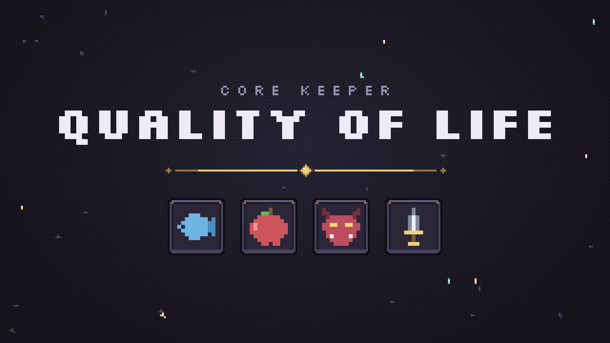

# Core Keeper QoL

Client-side quality-of-life tweaks, bundled as one PugMod mod. Other players do not
need it. Targets Core Keeper **1.3.0**.

Settings live in the game's own menu: **Settings > QoL settings**. Every feature is
on out of the box and has an Enabled toggle to switch it off.

## Features

**Auto Fishing**: casts and hooks for you, and stops baited spots depleting.

**Auto Eat**: eats when hunger passes a threshold, without changing the item you
have selected. Picks the smallest food that helps.

**Auto Summon**: keeps minions up as they expire or die, never past your cap.
Ctrl+R with a summoning weapon in hand toggles it for the session.

**DPS Tracker**: your damage per second, under the minion counter. Detailed mode
breaks it down by source, each with its icon.

**Chest Search**: start typing in the box beside the inventory and every
nearby chest, station, pouch and dropped stack holding that item is listed with a
count, and outlined in the world in a colour for how much is in there.

## Install

```sh
dotnet build -t:Install
```

Close the game first, mods are compiled at startup. Set `CK_GAME_DIR` if the game is not in
the default Steam library. Steam wipes the install folder on updates and on Verify
Integrity, so install again if the mod stops loading.

Settings are saved under `.../Pugstorm/Core Keeper/Steam/<id>/mods/CkQol/`. Delete that
folder to reset everything.

## Docs

- [Development and releasing](docs/development.md)
- [NOTES.md](NOTES.md): how each feature works, what the game's API allows, and the
  traps that cost a day each.

## License

MIT, see [LICENSE](LICENSE).

`assets/fonts/` is [Silkscreen](https://github.com/googlefonts/silkscreen) under the
SIL Open Font License, not MIT; its licence sits beside it.
